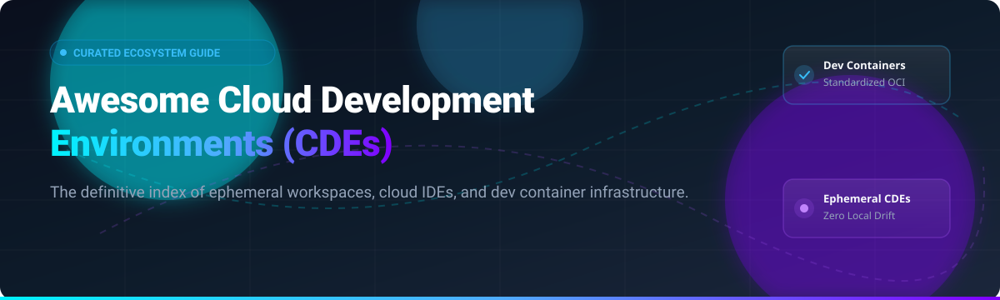

  

# ☁️ Awesome Cloud Development Environments (CDEs)

  
  
  
  
  
  

A curated directory and ecosystem guide covering **Cloud Development Environments (CDEs)**, **remote developer workspaces**, **ephemeral environments**, **Dev Container specifications**, and **self-hosted browser-based IDE infrastructure**.

Eliminate "works on my machine" issues by provisioning scalable, standardized, pre-configured development setups in seconds.

---

## 📑 Table of Contents

- [🌐 Sector Overview & Market Dynamics](#-sector-overview--market-dynamics)
- [💼 SaaS & Managed Hosted Platforms](#-saas--managed-hosted-platforms)
- [🔓 Open-Source GitHub Projects & Frameworks](#-open-source-github-projects--frameworks)
- [📊 Star History](#-star-history)
- [🤝 How to Contribute](#-how-to-contribute)
- [💖 Support & Sponsorship](#-support--sponsorship)
- [⚖️ Disclaimer](#-disclaimer)

---

## 🌐 Sector Overview & Market Dynamics

The global Cloud Development Environment (CDE) and Cloud IDE market is estimated at **$6.8 billion to $9+ billion** (growing at an aggressive **~17% CAGR** into the mid-2030s), propelled by distributed engineering teams, platform engineering standardization, and autonomous AI coding agents requiring sandboxed execution. The market remains **moderately fragmented**: while hyperscalers and platform giants (Microsoft/GitHub, Amazon, Google) dominate enterprise developer ecosystems, high-velocity specialists (Gitpod/Ona, Coder, Daytona, Replit, StackBlitz) capture significant specialized adoption through open standards (Dev Containers), local-to-cloud flexibility, and AI execution sandboxes.

---

## 💼 SaaS & Managed Hosted Platforms

The following SaaS platforms offer fully hosted or hybrid-managed Cloud Development Environments. Entries are sorted descending by company size (market valuation or parent revenue).

| Platform | Company Valuation / Scale | Pricing Model | Free Tier & Trial Limits | Description |
| :--- | :--- | :--- | :--- | :--- |
| **[AWS Cloud9](https://aws.amazon.com/cloud9/)** | **~$2.2 Trillion** *(Amazon Market Cap)* | **$0 IDE software charge**; pays underlying EC2/EBS infrastructure (starts at ~$0.0104/hr for `t3.micro` EC2) | **12 Months Free Tier**: 750 hrs/month of eligible Linux `t2.micro`/`t3.micro` instances + 30 GB EBS monthly storage | Cloud-based IDE featuring built-in terminal, code debugger, and direct AWS service integration. |
| **[Google Cloud Workstations](https://cloud.google.com/workstations)** | **~$2.1 Trillion** *(Alphabet Market Cap)* | Starts at **$0.05/vCPU/hr** management fee + Compute Engine VM rates (~$0.134/hr for `e2-standard-4`) + $0.20/cluster/hr | **90-Day Free Trial ($300 credits)** across Google Cloud; no permanent free tier (workstations draw against trial credits) | Enterprise-grade managed development environments with VPC-SC integration and private cluster security. |
| **[GitHub Codespaces](https://github.com/features/codespaces)** | **~$90 Billion+** *(Owned by Microsoft)* | Compute starts at **$0.18/hr** (2-core), $0.36/hr (4-core), $0.72/hr (8-core); Storage billed at **$0.07/GB/month** | **Free Forever**: 120 core hours/month (~60 clock hrs on 2-core) + 15 GB storage per month on personal accounts | Instant cloud development environments configured via Dev Containers directly in GitHub repositories. |
| **[Replit Teams](https://replit.com/)** | **$9.0 Billion** *(Series D, Mar 2026)* | **Replit Core**: **$20/month** (or $18/mo billed annually) with $20 usage credits included; **Teams/Pro**: $100/month | **Free Starter Tier**: Basic AI access (limited daily credits), 0.5 vCPU, 512MB RAM, ~20 hrs/mo dev time, 1 published app | Zero-setup collaborative browser IDE with instant runtime execution, AI pair programming, and app hosting. |
| **[StackBlitz Enterprise](https://stackblitz.com/)** | **$700 Million** *(Series B, Jan 2025)* | **Pro**: **$25/user/month** ($18/mo billed annually); **Teams**: **$60/member/month** ($55/mo billed annually); Enterprise custom | **Free Personal Tier**: Unlimited public projects, public GitHub repo editing, standard WebContainer browser runtime | Lightning-fast browser IDE powered by WebContainers executing full-stack Node.js environments client-side. |
| **[Coder Cloud](https://coder.com/)** | **~$300 Million** *(Series C, Apr 2026)* | **Community Edition**: **$0** self-hosted; **Enterprise Edition**: Annual contract per-user licenses via quote | **Free Forever Community Edition**: Unlimited self-hosted workspaces, unlimited single-org users, Terraform-driven | Self-hosted & enterprise-managed CDE provisioning multi-cloud developer environments via Terraform. |
| **[Daytona Cloud](https://www.daytona.io/)** | **$125 Million** *(Series A, Feb 2026)* | **Pay-as-you-go**: Usage-based pricing billed per second based on compute and memory allocations | **$200 Free Cloud Credits** upon signup (no credit card required) for sandboxes and agentic runtimes | Open-source foundation and managed cloud infrastructure optimized for AI agent code execution and instant CDEs. |
| **[Gitpod](https://www.gitpod.io/)** | **Acquired by OpenAI (2026)** *(~$100M+ est.)* | **Pay-as-you-go** metered usage after credits; Organization core plans start from **$9/user/month** | **Free Tier**: 500 credits per month (~50 standard workspace hours) for the first created organization | Automated ephemeral cloud development environments launched from git repos with automated prebuilds. |
| **[DevZero](https://www.devzero.io/)** | **~$35 Million** *($26M venture capital raised)* | **Pro**: **$5/CPU core/month** (or ~$7/core/month via AWS Marketplace); Custom enterprise tiers | **Free Forever Tier**: Full Kubernetes cluster resource & cost monitoring, cost attribution, and 30-day retention | Developer environments with instant environment cloning, snapshot restore, and Kubernetes cost management. |
| **[Codeanywhere](https://codeanywhere.com/)** | **Historical Platform** *(Acquired / Wound down)* | Historical tiers started at **$12/month** (Basic) and **$15/month** (Standard) prior to platform sunset | **7-Day Free Trial** historically offered prior to service sunset on July 1, 2026 | Pioneer cloud IDE offering browser-based containers, SSH server terminal connectivity, and remote deployment. |

---

## 🔓 Open-Source GitHub Projects & Frameworks

The following open-source tools and infrastructure stacks allow teams to build and host their own Cloud Development Environments. Repositories are ranked descending by GitHub star count, featuring live star badges linking to each repo's stargazers.

| Project & Repo | Stars | License | Primary Focus |
| :--- | :--- | :--- | :--- |
| **[code-server](https://github.com/coder/code-server)**  | ~79.6k | MIT | Run VS Code on any remote Linux machine and access it securely through any modern web browser. |
| **[Daytona](https://github.com/daytonaio/daytona)**  | ~71.5k | Apache-2.0 | Open-source development environment manager transforming any VM into a standardized developer workspace. |
| **[Eclipse Theia](https://github.com/eclipse-theia/theia)**  | ~21.7k | EPL-2.0 | Extensible cloud and desktop IDE framework with full VS Code extension protocol compatibility. |
| **[Nix](https://github.com/NixOS/nix)**  | ~17.9k | LGPL-2.1 | Purely functional package manager providing 100% reproducible and isolated system environments. |
| **[Coder](https://github.com/coder/coder)**  | ~17.0k | AGPL-3.0 | Self-hosted remote development platform provisioning CDEs across any cloud, bare metal, or k8s via Terraform. |
| **[Skaffold](https://github.com/GoogleContainerTools/skaffold)**  | ~15.9k | Apache-2.0 | Facilitates continuous development for Kubernetes applications with automated build, push, and deploy loops. |
| **[DevPod](https://github.com/loft-sh/devpod)**  | ~15.3k | MPL-2.0 | Client-only, unopinionated Codespaces alternative leveraging Dev Containers across AWS, GCP, Azure, k8s, or Docker. |
| **[E2B](https://github.com/e2b-dev/E2B)**  | ~14.4k | Apache-2.0 | Secure cloud sandboxes designed for AI coding agents and automated code execution environments. |
| **[Gitpod](https://github.com/gitpod-io/gitpod)**  | ~13.8k | AGPL-3.0 | Automated ephemeral workspace orchestration platform with prebuilds, container sandboxes, and k8s support. |
| **[Devbox](https://github.com/jetify-com/devbox)**  | ~12.4k | Apache-2.0 | Instant, portable, and predictable developer environments powered by Nix without container overhead. |
| **[Tilt](https://github.com/tilt-dev/tilt)**  | ~10.1k | Apache-2.0 | Microservice development tool providing live container updates and instant diagnostics for Kubernetes dev. |
| **[OpenVSCode Server](https://github.com/gitpod-io/openvscode-server)**  | ~6.2k | MIT | Run upstream Visual Studio Code directly in a remote browser window with minimal modifications. |
| **[Dev Containers Spec](https://github.com/devcontainers/spec)**  | ~5.8k | MIT | The open specification defining containerized development environments portable across modern CDEs. |
| **[Flox](https://github.com/flox/flox)**  | ~4.2k | GPL-2.0 | Virtual environment and package management tool built on Nix with a streamlined, team-friendly CLI. |
| **[Garden](https://github.com/garden-io/garden)**  | ~3.6k | MPL-2.0 | Production-like ephemeral testing and development environments for Kubernetes and microservices. |
| **[Nixpacks](https://github.com/railwayapp/nixpacks)**  | ~3.6k | MIT | Converts application source code into reproducible OCI container images using Nix packages. |
| **[Devcontainer CLI](https://github.com/devcontainers/cli)**  | ~3.0k | MIT | Official reference CLI implementation for parsing, building, and running Dev Container specifications. |
| **[devcontainer-features](https://github.com/devcontainers/features)**  | ~1.5k | MIT | Reusable and composable installation scripts and capabilities for devcontainer configurations. |
| **[Devcontainer Templates](https://github.com/devcontainers/templates)**  | ~1.4k | MIT | Starter configurations and templates for creating standardized devcontainers across programming ecosystems. |
| **[Brev CLI](https://github.com/brevdev/brev-cli)**  | ~276 | Apache-2.0 | Seamlessly connects local developer tools, IDEs, and shell sessions directly into remote cloud compute VMs. |

---

## 📊 Star History

---

## 🤝 How to Contribute

Contributions are warmly welcomed! Help keep this curated list up-to-date with emerging CDE standards and platforms:

1. **Fork the repository** to your GitHub account.
2. **Add or modify entries** in `README.md` adhering to the tabular layout and criteria.
3. **Verify criteria**: Provide factual descriptions, official documentation URLs, starting pricing tiers, and exact star badges.
4. **Submit a Pull Request** with a clear explanation of your additions or changes.

---

## 💖 Support & Sponsorship

If you find this curated CDE list valuable for your team or personal workflow, please consider:
- ⭐ **Starring this repository** to help others discover it
- 🍴 **Forking and sharing** with colleagues and developer communities
- ☕ **Supporting ongoing curation**: [Buy a coffee via GitHub Sponsors Dashboard](https://github.com/sponsors/ishandutta2007)

Thank you to all community contributors, builders, and maintainers driving the future of cloud-native development! 🙌

---

## ⚖️ Disclaimer

- This repository is a community-curated directory intended for research and educational purposes. Inclusion does not represent an endorsement.
- Ensure any cloud development environment adhering to corporate source code access adheres to internal data governance, SOC 2 compliance, and security policies.

---

  <b>Built for platform engineers, DevOps teams, and cloud development practitioners.</b> 
  Let's make Cloud Development Environments more open, data-driven, and reproducible.

